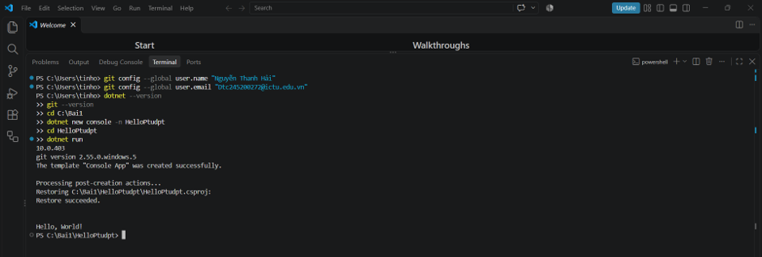
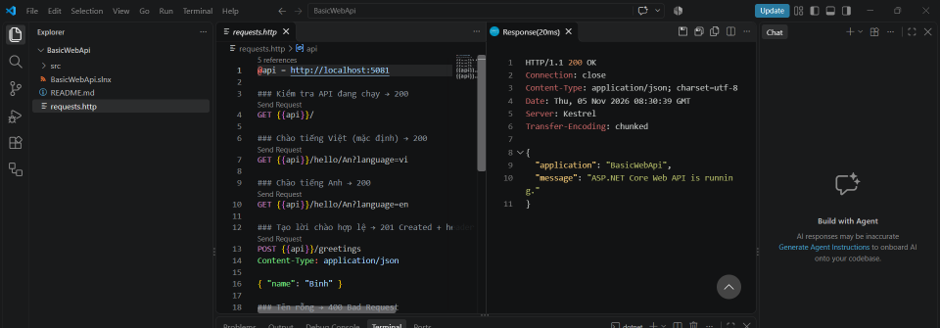
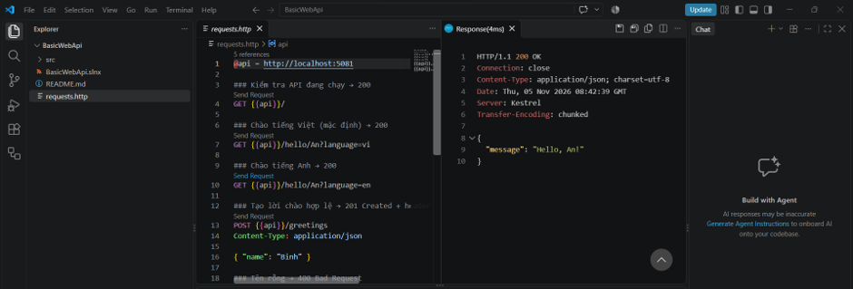
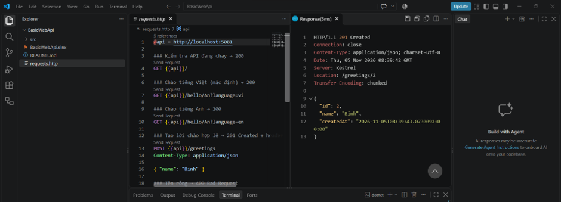
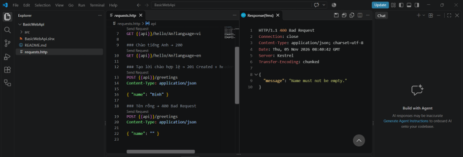
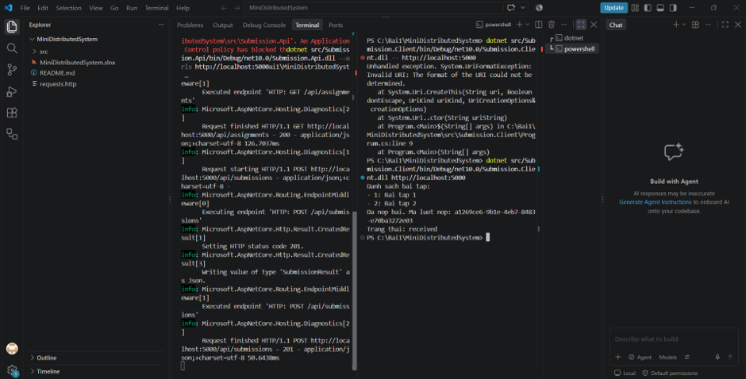
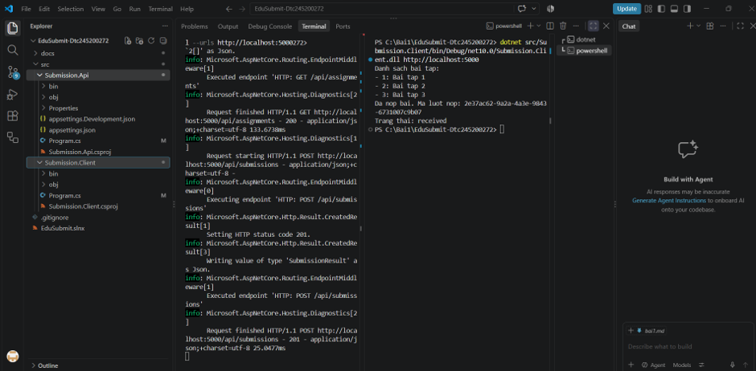

# Bài 1 – Tổng quan hệ thống và MEP
Họ tên: Nguyễn Thanh Hải              MSSV: DTC245200272

## 1. Cài đặt

## 2. MepDemo (Bước 7)
- MEP 3: Mỗi bài nộp sub-x chỉ do một worker chấm (các worker chia nhau việc).
- MEP 4: Một sự kiện được gửi tới cả 3 dịch vụ.
- Mô tả thêm: MEP 1 là Request-Response (Hỏi-Đáp), MEP 3 là Queue (Hàng đợi), MEP 4 là Publish-Subscribe (Xuất bản-Đăng ký).

## 3. BasicWebApi (Bước 8)
- REST Client:     
- Câu 1: Dòng `builder.Services.AddSingleton...` phải đứng trước `var app = builder.Build();`. Vì các dịch vụ phải được đăng ký trước khi ứng dụng được đóng gói (build).
- Câu 2: Tham số `name` được lấy từ đường dẫn (Route param), còn `language` lấy từ chuỗi truy vấn (Query string).
- Câu 3: Trả về 201 Created thay vì 200 OK vì hành động POST là để tạo mới tài nguyên, mã 201 thông báo dữ liệu mới đã được tạo thành công trên máy chủ.

## 4. MiniDistributedSystem (Bước 9)
- 
- Câu 1: Client gọi `GET /api/assignments` (nhận mã 200 OK) và gọi `POST /api/submissions` (nhận mã 201 Created).
- Câu 2: Hai tiến trình không dùng chung code, chúng thống nhất với nhau bằng hợp đồng giao tiếp qua mạng (URL và cấu trúc JSON).
- Câu 3: Địa chỉ API truyền qua tham số để linh hoạt. Khi đổi cổng hoặc đưa lên mạng thật, ta chỉ cần đổi tham số lệnh chạy mà không cần sửa code.

## 5. Thí nghiệm lỗi (Bước 10)
| # | Dự đoán | Thực tế | Đúng/Sai | Giải thích |
|---|---|---|---|---|
| a | | Client tự in ra thêm bài tập số 3 | | Client tải mảng JSON động, máy chủ thêm dữ liệu thì client tự cập nhật không cần sửa code. |
| b | | Client báo lỗi actively refused it | | Máy chủ tắt nên từ chối kết nối. Gọi qua mạng có thể thất bại bất cứ lúc nào do sập server, nghẽn mạng. |
| c | | Nhận mã 400 Bad Request, văng lỗi đỏ | | Máy chủ phải tự kiểm tra dữ liệu vì không thể tin tưởng 100% dữ liệu đẩy qua mạng. |
| d | | Client kết nối bình thường | | Truyền cổng 5050 thẳng vào lệnh chạy ở Terminal 2: `dotnet ...dll http://localhost:5050` |

## 6. Dự án EduSubmit tự làm (Bước 11-12)
- 
- Luồng thông điệp:
  Client --(HTTP GET /api/assignments)--> Api   : request-response
  Client --(HTTP POST /api/submissions)--> Api  : request-response

## 7. Khó khăn gặp phải và cách giải quyết
- Gặp lỗi AppLocker chặn file .exe. Cách giải quyết: Dùng lệnh chạy trực tiếp qua file .dll.
- Gặp lỗi UriFormatException khi chạy Client. Cách giải quyết: Xóa bỏ dấu `--` trước tham số URL để đường dẫn hợp lệ.